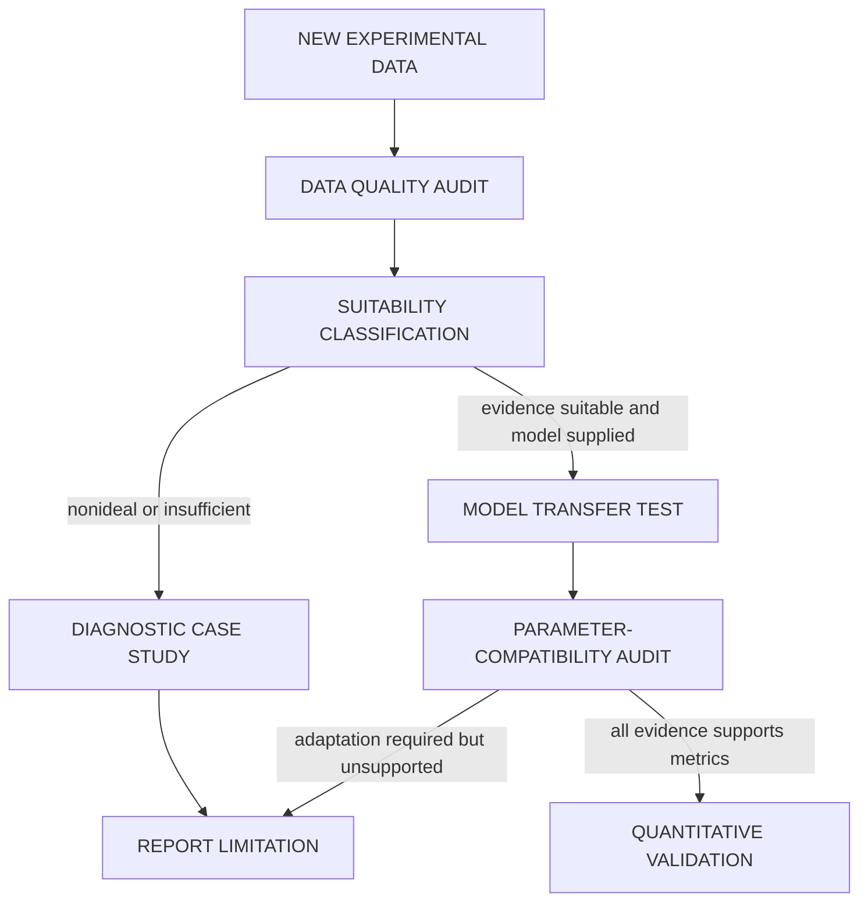

# Battery experimental-dataset assessment flow

The fenced JSON block is the machine-readable source for the rendered flow. Branches explicitly prevent unsuitable datasets from being promoted automatically to calibration or quantitative validation.

```json
{
  "schema_version": 1,
  "nodes": [
    {
      "id": "new_data",
      "label": "NEW EXPERIMENTAL DATA"
    },
    {
      "id": "quality",
      "label": "DATA QUALITY AUDIT"
    },
    {
      "id": "suitability",
      "label": "SUITABILITY CLASSIFICATION"
    },
    {
      "id": "diagnostic",
      "label": "DIAGNOSTIC CASE STUDY"
    },
    {
      "id": "transfer",
      "label": "MODEL TRANSFER TEST"
    },
    {
      "id": "compatibility",
      "label": "PARAMETER-COMPATIBILITY AUDIT"
    },
    {
      "id": "limitation",
      "label": "REPORT LIMITATION"
    },
    {
      "id": "validation",
      "label": "QUANTITATIVE VALIDATION"
    }
  ],
  "edges": [
    {
      "from": "new_data",
      "to": "quality",
      "condition": "always"
    },
    {
      "from": "quality",
      "to": "suitability",
      "condition": "always"
    },
    {
      "from": "suitability",
      "to": "diagnostic",
      "condition": "nonideal or insufficient"
    },
    {
      "from": "suitability",
      "to": "transfer",
      "condition": "suitable evidence and pre-existing model"
    },
    {
      "from": "transfer",
      "to": "compatibility",
      "condition": "always after transfer test"
    },
    {
      "from": "compatibility",
      "to": "limitation",
      "condition": "adaptation required but unsupported"
    },
    {
      "from": "compatibility",
      "to": "validation",
      "condition": "all required experimental evidence supports metrics"
    }
  ],
  "automatic_fit": false,
  "automatic_voltage_correction": false
}
```



Quantitative validation is conditional, not the default endpoint. The pipeline never triggers model fitting or voltage correction automatically.
